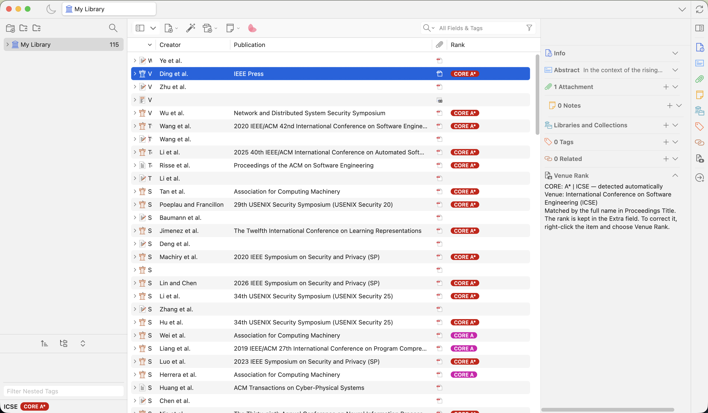

# Zotero CORE Ranking

A Zotero 10 plugin that shows the ranking of the conference or journal each
paper was published in, from [CORE](https://portal.core.edu.au/conf-ranks/) or
[CCF](https://www.ccf.org.cn/Academic_Evaluation/By_category/).



- A **Rank** column shows each paper's rank as a colored pill: CORE A\*
  (red), CORE A (magenta), CORE B (purple), and black for the rest; CCF ranks
  read CCF-A, CCF-B, CCF-C in the same colors. It sorts best first.
- The rank and the venue's acronym are kept together as one line of the
  item's Extra field, such as `CORE: A* | NeurIPS`, so they always come from
  the same match and sync with the item. The plugin adds no tags.
- Under the tag selector, at the bottom left, a strip shows the selected
  paper's venue acronym and rank pill, e.g. `NeurIPS` `CORE A*`. Click the
  acronym to correct it.
- A **Venue Rank** section in the item pane says which venue matched and why.
- New items are ranked automatically. When you change an item's venue fields
  (or its type), its rank and acronym are detected again.
- Rank and acronym can be corrected by hand. A corrected line is marked
  `(manual)` and never detected again.

## Install

1. Download `zotero-core-ranking.xpi` (or build it, see below).
2. In Zotero, open **Tools → Plugins**, click the gear button and choose
   **Install Plugin From File…**, then pick the `.xpi` file.
3. Right-click the item list's column header and turn on **Rank**.

The first time the plugin starts, it ranks every item in your editable
libraries that has no rank yet, and shows its progress in a popup. Later, the
same is available as **Tools → Rank Items Without a Venue Rank** (for the
selected library) and in the plugin's settings.

## Use

- **Edition.** Settings → CORE Ranking. The default is CORE ICORE2026; the list
  has every CORE edition back to 2008, and CCF 2026 (7th edition), which also
  ranks journals. Items are ranked with the chosen edition. To apply a new
  edition to items that already have a rank, click **Re-detect Detected Ranks**.
- **Correct a rank.** Right-click items → **Venue Rank** → **Set to CORE: A**,
  **Set to No Rank**, or **Detect Again from Venue**.
- **Correct an acronym.** Click it in the strip under the tag selector, type,
  and press Enter.
- **Find papers by rank.** Sort by the Rank column, or use Advanced Search with
  _Extra contains_ `CORE: A* |` (and save it as a saved search).

Pre-release versions (0.x) kept ranks as tags or the acronym on a line of its
own. The plugin moves those into the current format once.

How matching works: the plugin reads Proceedings Title, Conference Name,
Publication, Book Title and Journal Abbr, matches the full venue name first and
falls back to the acronym. Preprints get no rank. Workshops, Findings,
companion volumes and demos don't get the main conference's rank. Matching is
not perfect, so check surprising ranks in the item pane and correct them.

## Data

The ranking lists ship with the plugin in `addon/content/data/rankings/`, so it
works offline. `scripts/update_rankings.py` downloads them again:

- CORE: the CSV export of each edition from portal.core.edu.au.
- CCF: the official PDF of the 2026 list. CCF's web pages still show the 2022
  list.

The rankings belong to CORE and CCF. This plugin is not affiliated with either.

## Develop

The development tools come from Nix (`flake.nix`): Node.js 26, Python with
pdfplumber for the data script, jq and nixfmt.

```sh
nix develop          # enter the dev shell
npm ci               # install JavaScript dependencies
npm start            # run Zotero with the plugin, reloading on changes
npm test             # run the tests in a separate Zotero profile
npm run build        # build .scaffold/build/zotero-core-ranking.xpi
npm run data:update  # download the ranking lists again
```

`npm start` and `npm test` use `/Applications/Zotero.app` with their own
profiles (`.zotero-dev/` and `.scaffold/test/`), not your library.

Built from [zotero-plugin-template](https://github.com/windingwind/zotero-plugin-template).
Licensed under the AGPL-3.0.
